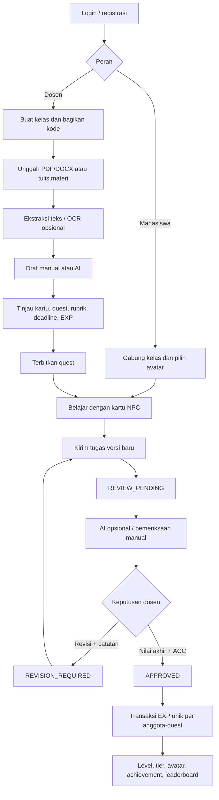
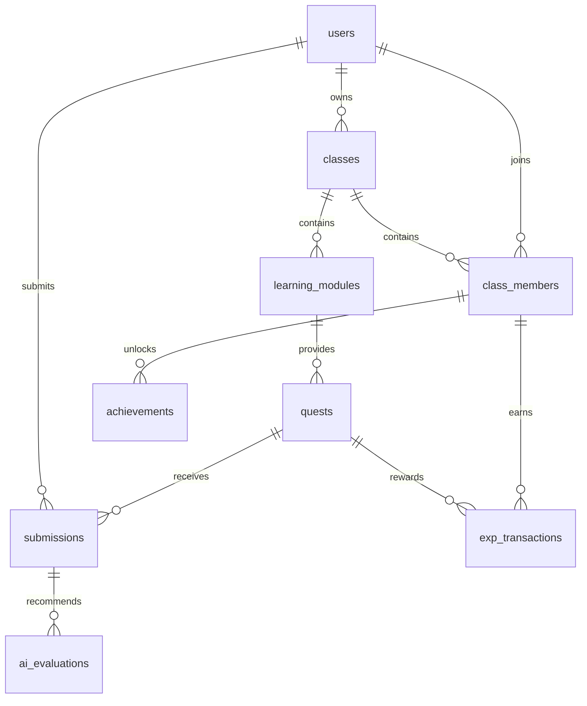
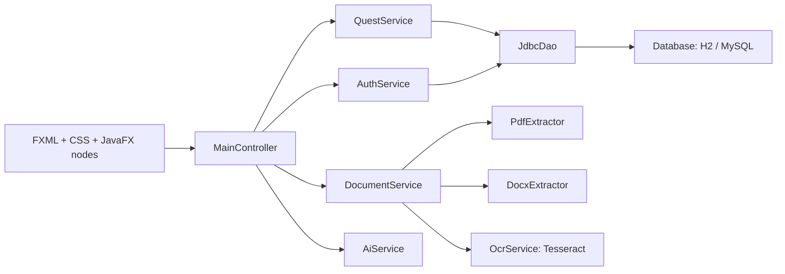

# Rancangan RetroQuest

## Dasar kebutuhan

Proposal PDF adalah spesifikasi utama: Java 21, JavaFX, Maven, MySQL/JDBC, PDFBox, POI, Tesseract, REST AI, MVC, DAO, dan service layer. Dokumen laporan yang lebih lama menekankan gamifikasi dan leaderboard; proposal PDF menambahkan modul, kartu belajar, OCR, AI, rubrik, serta versi submission. Implementasi menggabungkan cakupan tersebut dengan keputusan nilai akhir tetap pada dosen.

## Sketsa dan tata letak

Palet: latar navy `#0d1625`, panel `#152236`, aksen mint `#79e6c4`, reward emas `#ffd071`. Teks memakai Segoe UI; identitas retro dan angka memakai Consolas. Avatar digambar sebagai pixel melalui JavaFX Canvas sehingga tidak membutuhkan aset gambar eksternal. Sidebar tetap, isi halaman dapat digulir, dan dialog memiliki scroll untuk layar yang lebih kecil.

```text
LOGIN
┌────────────────────────────────┬──────────────────────────────┐
│ RETROQUEST / ACADEMIC ADVENTURE │ Selamat datang, adventurer   │
│                                │ Email                        │
│ Belajar. Berpetualang.          │ Password                     │
│ Naik level.                    │ [ Masuk ke guild ]           │
│                                │ [ Daftar akun ]              │
│           PIXEL AVATAR         │ Demo mahasiswa | Demo dosen  │
└────────────────────────────────┴──────────────────────────────┘

DASHBOARD
┌──────────────────┬───────────────────────────────────────────┐
│ RETROQUEST       │ GUILD ROOM [Pilih kelas ▼]  [+ Buat/Gabung]│
├──────────────────┼───────────────────────────────────────────┤
│ Dashboard        │ Dashboard                   KODE GUILD    │
│ Quest Board      │ ┌───────────────────────────────────────┐ │
│ Materi           │ │ Hero / aksi utama       Pixel avatar  │ │
│ Verifikasi /     │ └───────────────────────────────────────┘ │
│ Riwayat Tugas    │ [EXP/anggota] [Quest] [Pending] [Tier]    │
│ Leaderboard      │ Misi di guild-mu                          │
│ Profil           │ [Judul quest | tenggat | EXP | Buka]      │
│                  │ [Judul quest | tenggat | EXP | Buka]      │
│ [Akun] [Keluar]  │                                           │
├──────────────────┴───────────────────────────────────────────┤
│ Status operasi                              RETROQUEST 1.0   │
└──────────────────────────────────────────────────────────────┘

EDITOR QUEST                    VERIFICATION CENTER
┌──────────────────────────┐    ┌──────────────────────────────┐
│ Modul sumber             │    │ Mahasiswa / quest / versi    │
│ Judul dan instruksi      │    │ Instruksi + rubrik           │
│ Tenggat / jam / EXP      │    │ Pratinjau teks dan kode      │
│ Format berkas            │    │ [Buka berkas asli]           │
│ Kriteria | Bobot | Guide │    │ Rekomendasi AI / pesan gagal │
│ [ ] Sudah ditinjau       │    │ Nilai akhir + catatan dosen  │
│ [Simpan draf / terbit]   │    │ [Minta revisi] [ACC + EXP]   │
└──────────────────────────┘    └──────────────────────────────┘
```

## Alur utama



## Relasi database



SQL aktual berada di `src/main/resources/db/schema.sql`. `class_members(class_id,student_id)`, `submissions(quest_id,student_id,version)`, `exp_transactions(member_id,quest_id)`, dan `achievements(member_id,badge_code)` memiliki unique constraint. `final_score` dan `score_draft` terpisah. Nilai valid 0–100; EXP tidak negatif. Level dan tier dihitung dari EXP, tidak disimpan sebagai state terpisah.

## Arsitektur dan OOP



| Konsep | Implementasi |
|---|---|
| Enkapsulasi | User immutable dengan atribut private; perubahan quest, submission, dan progres melalui service tervalidasi |
| Abstraksi dan pewarisan | `abstract sealed User` diturunkan menjadi `Lecturer` dan `Student` |
| Polimorfisme/Strategy | Kontrak `DocumentExtractor` dipenuhi PDF, DOCX, dan OCR |
| Factory | `AvatarFactory.create(archetype, exp, scale)` menghasilkan avatar sesuai tier dan arketipe |
| Observer | `QuestService.observe` menerbitkan notifikasi setelah perubahan data berhasil di-commit |
| Singleton terbatas | `AppConfig.get()` mengelola konfigurasi, bukan koneksi global |
| Transaksi | `Database.transaction` commit/rollback dan menutup koneksi per operasi |
| Concurrency | JavaFX `Task` untuk query halaman, ekstraksi/OCR, dan HTTP AI; pembaruan node pada application thread |

FXML menyediakan shell; isi halaman dan formulir dibentuk controller sebagai node JavaFX. Ini bukan kumpulan FXML terpisah per layar. Query memakai prepared statements dan tidak menerima SQL dari pengguna. Timer 15 detik memuat ulang progres antarklien saat tidak ada dialog aktif; belum memakai WebSocket.

## Aturan state

- Quest: `DRAFT → PUBLISHED`. Quest terbit dibekukan.
- Submission: tersimpan sebagai `REVIEW_PENDING`, kemudian `REVISION_REQUIRED` atau `APPROVED`.
- Setiap revisi menambah versi. Versi lama tidak ditimpa dan tidak dapat dinilai ulang setelah versi baru muncul.
- AI: `SUCCESS` atau `FAILED`, dengan waktu, rekomendasi, teks ekstraksi, dan pesan kesalahan.
- Approval dan reward memakai satu transaksi, mengunci keanggotaan dan submission. Persetujuan ulang bersifat idempoten.
- Sebuah anggota mendapatkan full reward quest setelah ACC; nilai akhir tidak mengalikan jumlah EXP.
- Tenggat berlaku juga untuk revisi. Dosen perlu menetapkan tenggat cukup panjang; fitur perpanjangan individual belum tersedia.

Achievement: `FIRST_QUEST` pada persetujuan pertama; `ADEPT` pada 300 EXP; `ELITE` pada 700; `LEGENDARY` pada 1000; `QUEST_MASTER` pada 5 quest terverifikasi. Semua berlaku per kelas.

## Pembagian pemahaman tim

| Anggota sesuai proposal | Bagian untuk dipelajari/dipresentasikan |
|---|---|
| Rifqi Aditya | Skema SQL, DAO, transaksi EXP, ekstraksi, OCR, AI |
| Muhammad Rizqi Firdaus | FXML/CSS, layout halaman, kartu NPC, avatar, profil dan leaderboard |
| Mohammad Shofwan Ainun Na'im | Controller, JavaFX Task, validasi akses, integrasi, pengujian |

Pembagian ini mengikuti proposal dan merupakan panduan mempelajari source yang telah dibuat; bukan klaim kontribusi riil anggota.
